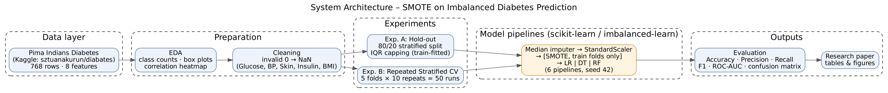
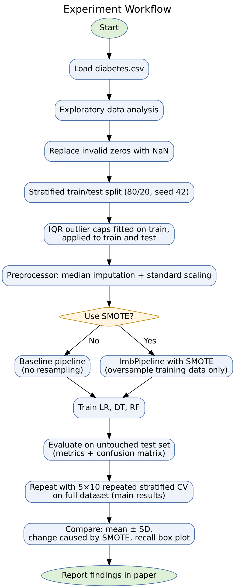
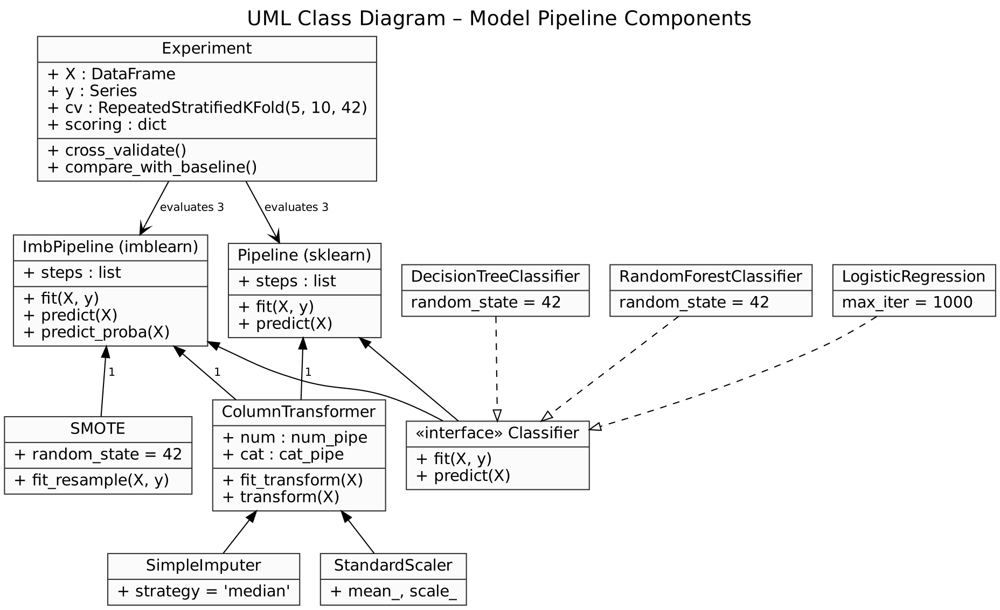

# Project Design

| Diagram | Description |
|---|---|
| `system_architecture.png` | End-to-end architecture: data source → preparation → two experiments → model pipelines → evaluation → paper |
| `workflow_flowchart.png` | Step-by-step flowchart of the experiment, including the SMOTE / no-SMOTE branch |
| `uml_pipeline_class_diagram.png` | UML class diagram of the scikit-learn / imbalanced-learn components used to build each model pipeline |

The `.dot` files are the Graphviz sources. To regenerate a diagram, run `dot -Tpng <file>.dot -o <file>.png`.

**UI design:** this is a research and experimentation project that runs as a Jupyter notebook, so it has no user interface. The notebook's charts and tables (see `../Screenshots/`) are how the results are presented.

## System Architecture

## Workflow Flowchart

## UML Class Diagram

*`Experiment` is a conceptual class. It stands for the cross-validation loop in the notebook. All other classes are real library classes.*
