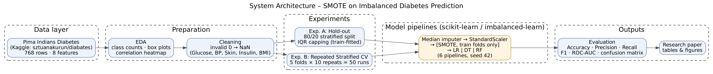
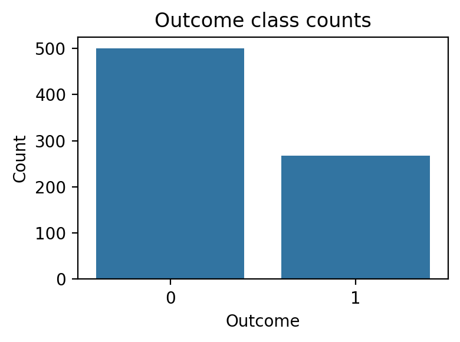
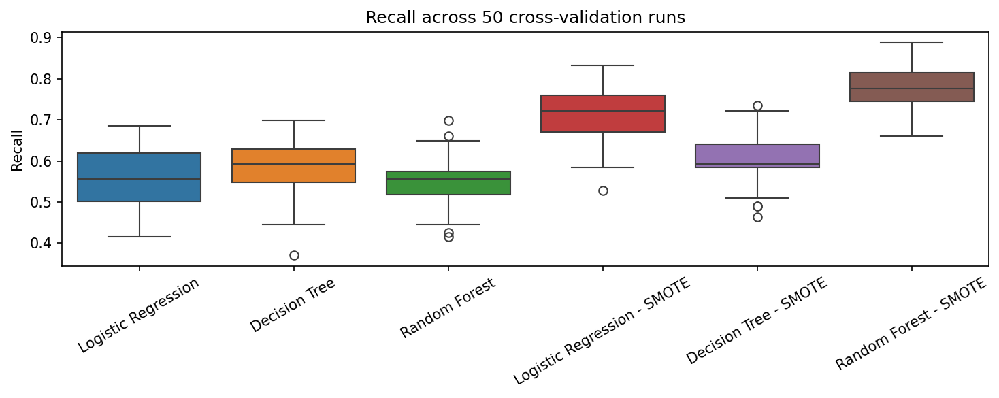

# Effect of SMOTE on Imbalanced Diabetes Prediction

**Applied Machine Learning Lab (CSE2512P) — IILM University, Gurugram**

This project measures how SMOTE (Synthetic Minority Over-sampling Technique) changes the performance of three classifiers (Logistic Regression, Decision Tree and Random Forest) on the imbalanced Pima Indians Diabetes dataset. Each model is trained with and without SMOTE. The models are compared on precision, recall, F1-score and ROC-AUC using stratified 5-fold cross-validation repeated 10 times.

**Original project repository (cited in the research paper):** https://github.com/AkashSivanandan245/aml-project

## Team Members

| # | Name | URN |
|---|---|---|
| 1 | Akash Sivanandan | 2481026 |
| 2 | Dhananjay Kumar | 2481033 |
| 3 | Girish Khanna | 2481150 |
| 4 | Soumen Kumar Dutta | 2481248 |

## Objectives

1. Find out how class imbalance (34.9% diabetic vs 65.1% non-diabetic) affects standard classifiers, especially their ability to find diabetic patients (recall).
2. Apply SMOTE correctly: only to the training data, inside a pipeline, so no synthetic samples leak into evaluation.
3. Compare Logistic Regression, Decision Tree and Random Forest before and after SMOTE on the same data splits.
4. Report results that are reliable, using repeated stratified cross-validation (50 runs), not a single train/test split.

## Technologies Used

| Category | Tools |
|---|---|
| Language | Python 3.13 |
| Environment | Jupyter Notebook (Kaggle Notebooks) |
| Data handling | pandas 2.3.3, NumPy 2.1.3 |
| Machine learning | scikit-learn 1.6.1 |
| Imbalance handling | imbalanced-learn 0.14.2 (SMOTE, `imblearn.Pipeline`) |
| Visualisation | Matplotlib 3.10.0, Seaborn 0.13.2 |
| Data download | kagglehub |
| Version control | Git, GitHub |

## Results

Main results from 5-fold stratified cross-validation repeated 10 times (mean ± SD over 50 runs):

| Model | Accuracy | Precision | Recall | F1-score | ROC-AUC |
|---|---|---|---|---|---|
| Logistic Regression | 0.767 ± 0.029 | 0.713 ± 0.058 | 0.558 ± 0.067 | 0.624 ± 0.054 | 0.835 ± 0.027 |
| Decision Tree | 0.700 ± 0.038 | 0.571 ± 0.058 | 0.582 ± 0.072 | 0.574 ± 0.055 | 0.673 ± 0.041 |
| Random Forest | 0.763 ± 0.026 | 0.709 ± 0.056 | 0.548 ± 0.056 | 0.616 ± 0.046 | 0.840 ± 0.026 |
| Logistic Regression + SMOTE | 0.755 ± 0.035 | 0.633 ± 0.049 | 0.716 ± 0.063 | 0.670 ± 0.047 | 0.835 ± 0.028 |
| Decision Tree + SMOTE | 0.695 ± 0.032 | 0.559 ± 0.045 | 0.604 ± 0.058 | 0.579 ± 0.044 | 0.674 ± 0.035 |
| Random Forest + SMOTE | 0.757 ± 0.031 | 0.622 ± 0.040 | **0.779 ± 0.049** | **0.691 ± 0.037** | 0.835 ± 0.029 |

**Key findings**
- SMOTE raised recall sharply for Logistic Regression (0.558 → 0.716) and Random Forest (0.548 → 0.779), so far fewer diabetic patients were missed.
- Precision fell as a trade-off, but F1-score still improved for all three models.
- ROC-AUC barely changed. This suggests SMOTE mainly shifts where the models draw the line between classes, rather than improving how well they rank patients.
- The Decision Tree gained the least, and it was the weakest model with or without SMOTE.
- Random Forest + SMOTE gave the best balance (highest recall and F1).

## Repository Structure

```
├── README.md                 Project overview (this file)
├── Source-Code/              Jupyter notebook and requirements.txt
├── Project-Design/           System architecture, workflow flowchart, UML class diagram
├── Dataset/                  Pima Indians Diabetes dataset (diabetes.csv)
├── Documentation/            Research paper (PDF) and technical documentation
└── Screenshots/              EDA plots, confusion matrices, cross-validation results
```

## How to Run

```bash
pip install -r Source-Code/requirements.txt
jupyter notebook Source-Code/research-paper-final.ipynb
```

The notebook was written for Kaggle. To run it locally, change the data-loading line to read `Dataset/diabetes.csv`. [Documentation/Technical-Documentation.md](Documentation/Technical-Documentation.md) gives the full steps.

## Project Design



## Selected Screenshots

| Class imbalance | Recall across 50 CV runs |
|---|---|
|  |  |

All screenshots are listed in [Screenshots/README.md](Screenshots/README.md).
