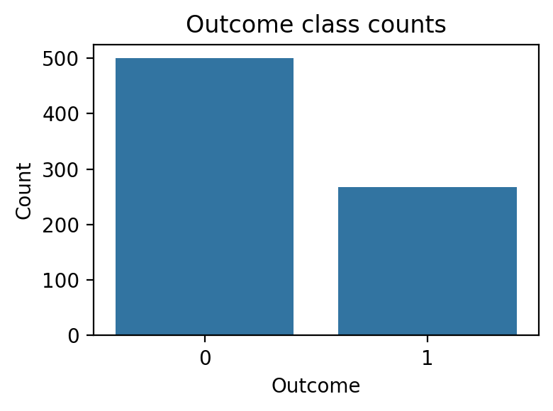
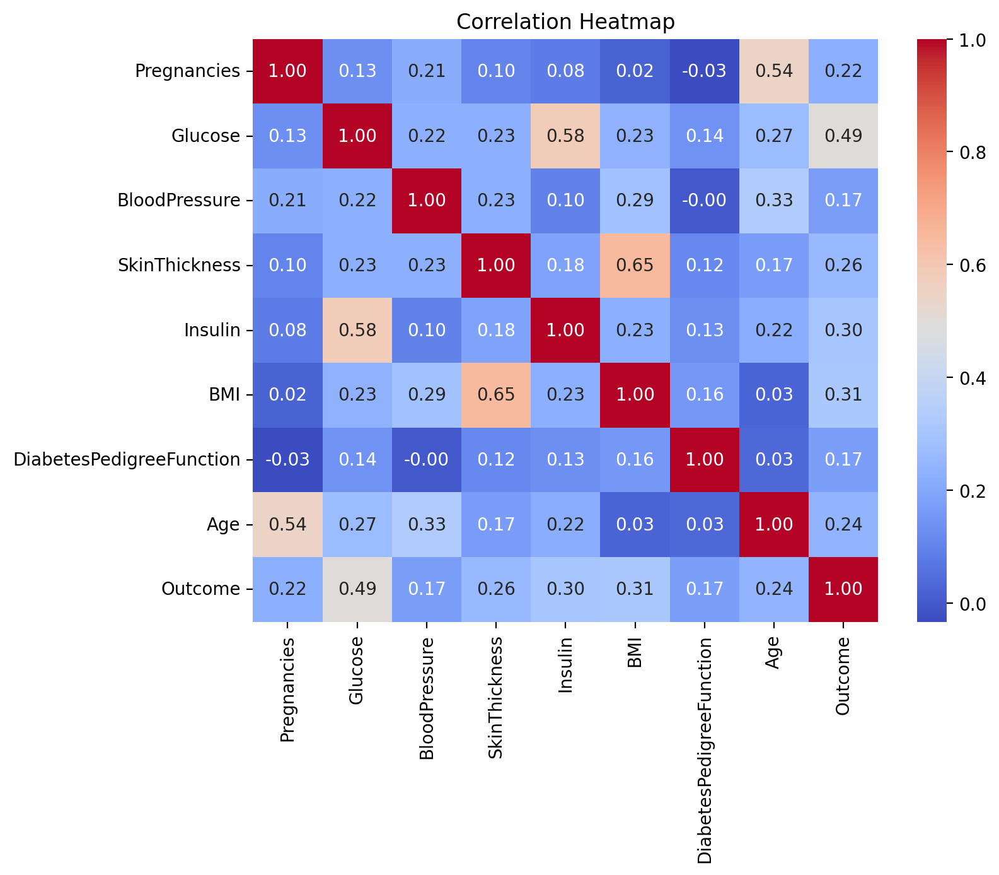
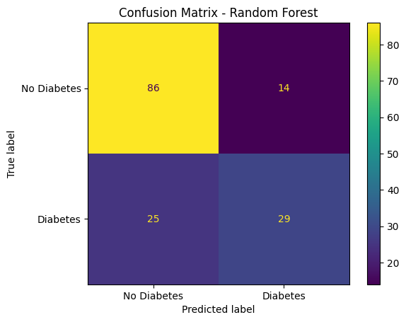
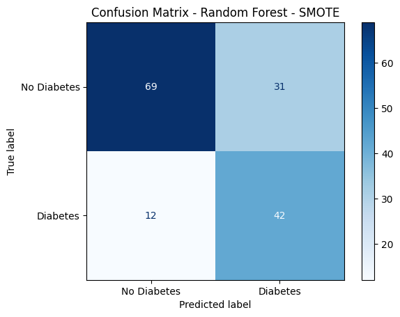
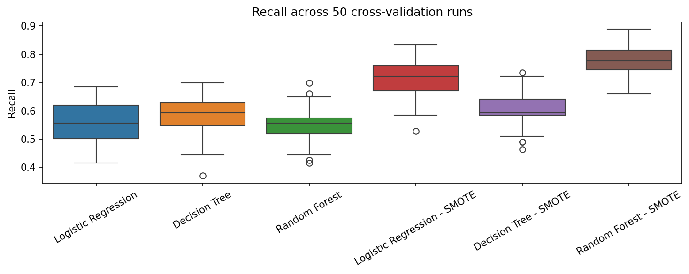

# Screenshots

All images are outputs of `Source-Code/research-paper-final.ipynb`.

| File | Shows | Paper item |
|---|---|---|
| `01_class_counts.png` | Outcome class counts (class imbalance) | Fig. 1 |
| `02_boxplot_<feature>.png` | Distribution of each feature by Outcome (8 plots) | EDA |
| `03_correlation_heatmap.png` | Correlation between features and Outcome | Fig. 2 |
| `04_confusion_matrix_<model>_baseline.png` | Hold-out confusion matrices without SMOTE | Fig. 5 |
| `05_confusion_matrix_<model>_SMOTE.png` | Hold-out confusion matrices with SMOTE | Fig. 5 |
| `06_recall_boxplot_cross_validation.png` | Recall across 50 cross-validation runs, all six models | Fig. 4 |

## Class imbalance

## Correlation heatmap

## Confusion matrices: Random Forest without vs with SMOTE
| Without SMOTE | With SMOTE |
|---|---|
|  |  |

## Recall across 50 cross-validation runs

